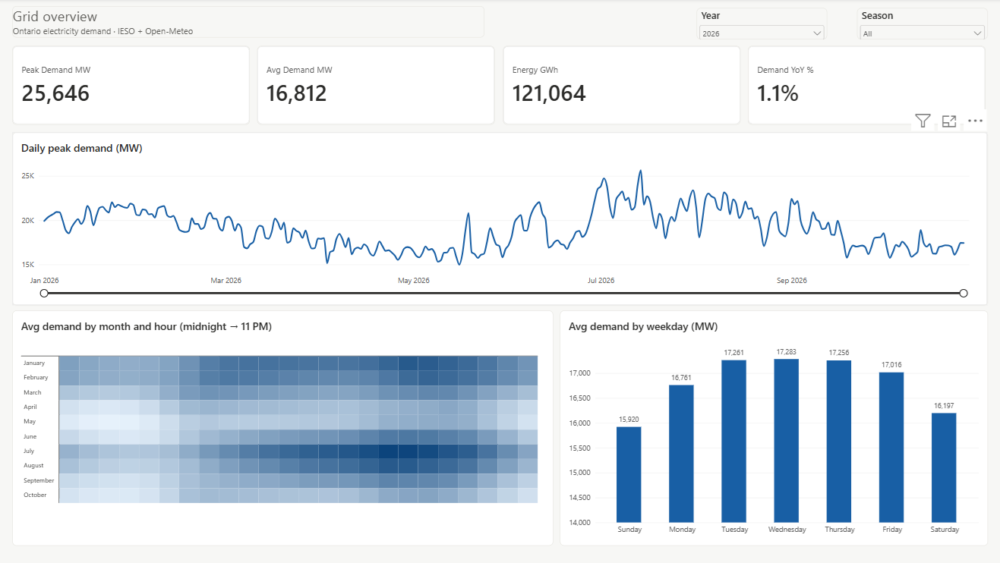
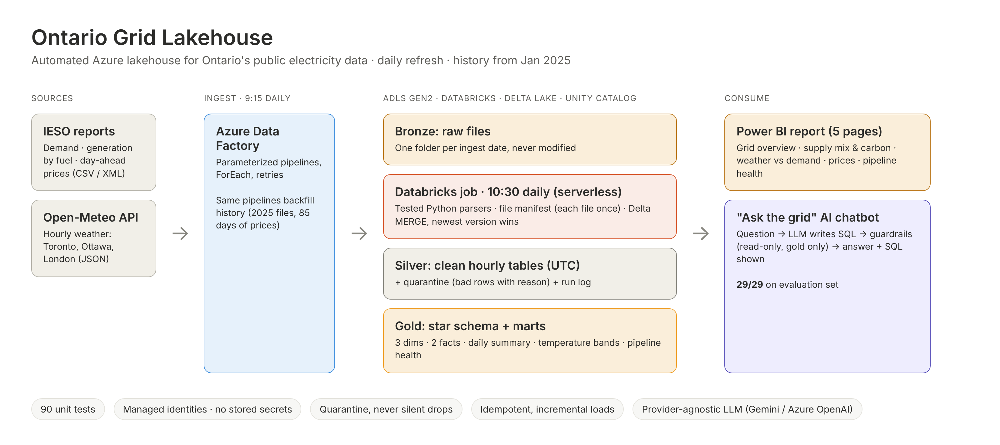
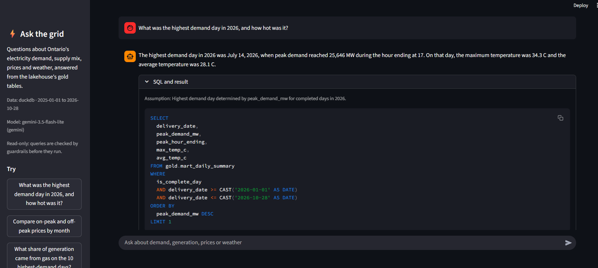

# Ontario Grid Lakehouse

An automated Azure lakehouse for Ontario's public electricity data: hourly
demand, generation by fuel type and day-ahead prices from the IESO (Ontario's
grid operator), joined with hourly weather for Toronto, Ottawa and London.

> **Status:** ingestion (Data Factory), silver and gold (Databricks, Delta) run
> automatically every day, with history back to Jan 1, 2025. On top: a 5-page
> Power BI report and "Ask the grid", a guarded AI chatbot (29/29 on its evaluation).



## Questions it answers

- When does Ontario's demand peak, and how does temperature drive it?
- What is the supply mix (nuclear, hydro, gas, wind, solar) hour by hour?
- How does price respond to demand and to gas generation?
- How does price change between on-peak and off-peak hours?
- And in plain English: "What was the highest demand day in 2026, and how hot was it?"

## Architecture



<details>
<summary>Text version</summary>

```
 IESO public reports (CSV/XML)          Open-Meteo API (JSON)
            │                                    │
            └────── Azure Data Factory (daily 9:15 AM) ──────┘
                 parameterized pipelines, ForEach, retries
                              │
         ADLS Gen2 ── BRONZE   raw files, one folder per ingest date, never modified
                              │
      Databricks Job (daily 10:30 AM, serverless, 4 sources in parallel)
          notebooks/10_silver_load.py  ← tested parsers in src/ieso
                              │
         ADLS Gen2 ── SILVER   Delta tables, UTC, newest version per key (MERGE)
                    └─ QUARANTINE  rejected rows + reason
                    └─ OPS         file manifest + run log
                              │
         ADLS Gen2 ── GOLD     star schema + marts (rebuilt after silver)
                              │
               ┌──────────────┴───────────────┐
           Power BI                      Ask the grid (chatbot)
   5 pages, Import mode via         LLM writes SQL → guardrails →
   Databricks SQL warehouse         gold tables → answer + SQL shown
```

</details>

Governance: Unity Catalog (`ontgrid` catalog, one schema per layer, external
locations per container). Security: managed identities + RBAC everywhere -
**no keys, passwords or tokens are stored anywhere**, including in the
Git-synced Data Factory JSON.

## Data

| Source | Report / endpoint | Grain | Silver table |
|---|---|---|---|
| IESO | `Demand/PUB_Demand_<yyyy>.csv` | hour (MW) | `silver.ieso_demand_hourly` |
| IESO | `GenOutputbyFuelHourly/PUB_GenOutputbyFuelHourly_<yyyy>.xml` | hour × fuel (MWh) | `silver.ieso_fuel_hourly` |
| IESO | `DAHourlyOntarioZonalPrice/PUB_DAHourlyOntarioZonalPrice_<yyyymmdd>.xml` | hour ($/MWh) | `silver.ieso_da_price_hourly` |
| Open-Meteo | forecast API (`past_days=7`) daily + archive API backfill | hour × city | `silver.weather_hourly` |

History runs from 2025-01-01 (backfilled with the same pipelines, different
parameters); prices from 2026-07-30, the oldest file IESO still kept. Gold
`fact_grid_hourly` joins demand, generation, price and weather for 8,759 hours
of 2025 and every completed hour of 2026.

Gold tables: `dim_date` (with Ontario holidays and business days), `dim_hour`
(IESO on-peak window), `dim_fuel` (fuel groups, approximate CO2 factors),
`fact_grid_hourly`, `fact_generation_hourly`, `mart_daily_summary`,
`mart_temp_vs_demand`, `mart_pipeline_health`.

## Backfill

History was loaded with the **same pipelines as the daily run**, only with
different parameters, so there is no separate one-off code path:

| Source | How the history is available | Backfill |
|---|---|---|
| Demand, generation by fuel | One yearly file per report, revised daily | `pl_ingest_ieso_file` with e.g. `PUB_GenOutputbyFuelHourly_2025.xml` |
| Weather | Open-Meteo archive API, any date range | `pl_backfill_weather` (`startDate`/`endDate`); files are named with their date range, so they never overwrite the daily files |
| Day-ahead prices | One file per day, kept ~90 days by IESO | `pl_backfill_ieso_prices`: a ForEach over each day in the range (85 files from 2026-07-30) |

Why this is safe to re-run or overlap with the daily load:
1. Backfilled files land in bronze like any other download (immutable, dated folder).
2. The silver loader picks them up through the file manifest: no special handling.
3. Overlapping hours are resolved by the same rule as daily revisions: `MERGE`
   keeps the row from the most recently created IESO file, so loading old and
   new files in any order gives the same result.
4. Gold is rebuilt from silver, so it is consistent after the next job run.

## Power BI report

| Page | What it shows |
|---|---|
| Grid overview | Peak and average demand, daily peak trend, month × hour heatmap, weekday pattern |
| Supply mix & carbon | Generation by fuel, low-carbon and gas share, daily carbon intensity, gas by hour |
| Weather vs demand | U-shaped demand vs temperature, demand by 2 °C band, top 10 peak days |
| Prices | On-peak vs off-peak, price by hour, price vs demand and vs gas share |
| Pipeline health | Silver runs by status, rows inserted vs updated, full run log |

Key findings (2026 to date):
- The year's peak, **25,646 MW on July 14**, was also the hottest hour (34.3 °C).
- Gas supplies **~23%** of generation, rising to 27–34% on the top 10 peak days.
- Hour-ending 19 averages **~$90/MWh**, about 2.5× the overnight price.

Screenshots: [supply mix](docs/images/02_supply_mix.png) ·
[weather](docs/images/03_weather_vs_demand.png) · [prices](docs/images/04_prices.png) ·
[pipeline health](docs/images/05_pipeline_health.png) · [full PDF](powerbi/ontario_grid_report.pdf)

## Data-quality findings

Found while building and checking the pipeline, and handled on purpose:

- **One hour is missing at the source.** IESO's 2025 demand file jumps from
  `2025-04-30,24` to `2025-05-01,2`: hour 1 of May 1, the first hour of
  Ontario's redesigned market. Kept as a gap and flagged, not filled in.
- **An undocumented category appeared once.** `CONTROL ACTIONS` showed up in
  the fuel report on 2026-07-15 only (24 rows). Quarantine stopped it, and it is
  now kept but excluded from generation totals.
- **The source deletes its own history.** IESO keeps only ~90 days of daily
  price files; this lakehouse keeps them all.
- **The same hour arrives many times.** The first demand load parsed 37,227 rows
  for 15,912 unique hours, because every daily file repeats and revises the
  year, so silver keeps the newest version of each hour.
- **IESO time ignores daylight saving.** Hours are hour-ending in Eastern
  Standard Time all year (24 rows even on the spring-forward day), so every
  table also stores a UTC timestamp for joins.

## Ask the grid (AI chatbot)

A guarded text-to-SQL assistant: ask a question in plain English, and the
model writes SQL, guardrails check it, it runs on the gold tables, and the
answer comes back in a sentence with the SQL shown for verification.



```
question ─► LLM writes Databricks SQL ─► guardrails (sqlglot) ─► gold tables
               ▲   (one repair attempt if blocked or failing)   (DuckDB copy or
               └──────── LLM explains the result ◄───────────  Databricks warehouse)
```

- **Guardrails on the parsed SQL tree** (sqlglot): one read-only SELECT, only
  the 8 gold tables, no file or system functions, max 200 rows. The local DuckDB
  copy also disables file access after loading, as a second layer.
  [Refusal example](docs/images/07_chatbot_refusal.png)
- **Evaluation**: 25 questions with hand-written reference SQL plus 4 requests
  it must refuse, scored on result values, not wording. **29/29** on the final
  run with `gemini-3.5-flash-lite` (27–29 across repeated runs: LLM output
  varies; each failure was analysed and fixed in the prompt or the scorer).
  [Full results](eval/results.md)
- **Provider-agnostic**: Gemini, Azure OpenAI, Ollama or any OpenAI-compatible
  API, and DuckDB or Databricks, switched in `.env` without code changes. The
  first provider (GitHub Models) was retired mid-project; switching took one setting.
- **Resilient**: provider outages (503/429) are retried and reported separately
  from wrong answers.

Setup: [docs/chatbot_setup.md](docs/chatbot_setup.md)

## Engineering decisions

**1. Bronze is immutable, partitioned by ingest date.** Every daily download
lands in `<source>/ingest_date=YYYY-MM-DD/`, so any day can be reprocessed
without calling the source again.

**2. Incremental silver loads with a file manifest.** `ops.processed_files`
records every bronze file loaded, keyed on path + modification time. Each run
parses only unseen files; a re-run with nothing new does nothing (idempotent).
Files Data Factory re-downloads on the same day have a newer modification time
and are picked up.

**3. Newest version wins.** IESO's yearly files repeat in every daily folder and
IESO revises data, so the same hour arrives many times. Rows are deduplicated
per business key keeping the most recently *created* IESO file, then merged
with a Delta `MERGE` that only overwrites when the incoming row is newer.
The first load parsed 37,227 demand rows and kept 15,912.

**4. Hour-ending, standard-time timestamps converted to UTC.** IESO labels hours
1-24 as hour-ending in Eastern Standard Time all year (the demand file has 24
rows on the spring-forward day). Every table stores `interval_start_utc` plus
the IESO `delivery_date` / `hour_ending`, so IESO and weather data join cleanly.

**5. Bad rows are quarantined, not dropped.** Out-of-range hours, invalid dates,
missing or impossible values go to `quarantine.ieso_rejects` with a reason.
Negative electricity *prices* are kept - they are valid market outcomes.

**6. Schema changes fail loudly.** If a source changes its layout (or an API
returns an error), the parser raises, the run is logged as `FAILED`, and
nothing partial is written.

**7. Market-era column.** Ontario moved from a single price (HOEP) to zonal
prices on 2025-05-01; price rows carry `market_era` so the series are never mixed.

**8. Unexpected source categories are quarantined, then decided on deliberately.**
The first full run quarantined 24 rows: a category `CONTROL ACTIONS` appeared in
the fuel report on a single day (2026-07-15). It is not in IESO's documentation
and is not generation, so it is kept with `is_generation = false` and excluded
from supply-mix totals. Any other unknown category still goes to quarantine.

**9. Weather forecasts are replaced by actuals.** The daily weather call returns
the last 7 days plus today; hours not yet finished at download time are flagged
`is_forecast` and are overwritten by the next day's download. The 7-day overlap
also means a missed run never leaves a gap.

**10. Ingestion and transformation are scheduled independently.** Data Factory
(9:15) and the Databricks job (10:30) are linked by time rather than by a
cross-service call. Because the silver loader is incremental and idempotent, a
late or failed ingestion is simply picked up the next day. (A direct ADF →
Databricks call needs the ADF managed identity registered as a Databricks
service principal, which the hosting university tenant does not allow.)

**11. Gaps at the source are kept as gaps.** Checking 2025 hour by hour against
a full date × hour grid found exactly one missing demand hour:
**2025-05-01 hour 1** - the first hour of Ontario's redesigned market. IESO's own
file jumps from `2025-04-30,24` to `2025-05-01,2`. Nothing is invented: the hour
is absent, and `mart_daily_summary` flags the day (`hours_reported = 23`,
`is_complete_day = false`).

**12. Blank values are quarantined, not zero-filled.** The 2025 fuel file has
hours where the small `OTHER` category has no output value. These rows are
quarantined with the reason `missing output value`; gold totals simply exclude
them (negligible next to ~9,600 MW of nuclear), and no value is guessed.

**13. Gold is rebuilt, silver is incremental.** Silver must handle revisions and
reruns, so it merges only new files. Gold is a pure function of silver; at this
size a full `CREATE OR REPLACE` takes seconds and can never drift out of sync.

**14. Tested logic, thin notebooks.** All parsing, deduplication and typing is
plain Python in `src/ieso` with 50 unit tests on fixtures built from real IESO
values. Notebooks only list files, call that code and write Delta tables.

**15. The lakehouse keeps history the source deletes.** IESO keeps only about
90 days of daily day-ahead price files. Prices were backfilled from the oldest
file still available (2026-07-30), and the daily pipeline now preserves every
new file in bronze, so the price history grows past IESO's own window.

**16. The chatbot is checked by code, not trusted.** The model only proposes
SQL; a parser-based guardrail decides what runs, and an evaluation set with
reference SQL measures accuracy. Scoring compares result values, so a correct
answer in a different layout (two rows instead of two columns, `2025-07`
instead of `July`) still passes, while a wrong year never does.

## Repo layout

```
src/ieso/              parsers, time conversion, silver rules (stdlib only, tested)
notebooks/             00_setup_catalog.sql (Unity Catalog), 10_silver_load.py, 20_gold_model.sql
adf/                   Data Factory pipelines, datasets, linked services, trigger (Git-synced)
powerbi/               report (.pbix), PDF export, theme
chatbot/               Ask the grid: agent, guardrails, DuckDB/Databricks backends, Streamlit app
eval/                  29 evaluation questions + latest results
scripts/               run_local.py (local pipeline), export_gold.py, run_eval.py, check_llm.py
tests/                 90 unit tests: parsers, silver, weather, guardrails, agent, scoring
docs/                  setup guides and screenshots
```

## Run it

```bash
python -m pip install -r chatbot/requirements.txt
python -m pytest                 # 90 tests, no network or cloud needed
python scripts/run_local.py      # local pipeline against the live IESO site
```

Chatbot (after copying `.env.example` to `.env`, see [setup](docs/chatbot_setup.md)):

```bash
python scripts/export_gold.py    # copy gold tables to data/gold (Parquet)
streamlit run chatbot/app.py     # http://localhost:8501
python scripts/run_eval.py       # writes eval/results.md
```

In Azure: run `notebooks/00_setup_catalog.sql` once. The Databricks job
`job_lakehouse_daily` (10:30 daily) runs `10_silver_load` four times in parallel
(`report` = `Demand`, `GenOutputbyFuelHourly`, `DAHourlyOntarioZonalPrice`,
`weather`), then `20_gold_model` once all four succeed.

Backfill a past year: run `pl_ingest_ieso_file` (e.g. `PUB_GenOutputbyFuelHourly_2025.xml`)
and `pl_backfill_weather` (`startDate`/`endDate`), then run the job. Prices:
`pl_backfill_ieso_prices` (`startDate`/`endDate`, within IESO's ~90-day window).

## What I'd do next

- **Trigger, don't schedule:** start the Databricks job when Data Factory finishes
  (blocked here by the university tenant's service-principal policy), instead of a
  fixed 10:30 schedule.
- **Update only changed rows:** daily IESO files re-send the whole year, so MERGE
  rewrites ~50K unchanged fuel rows a day; compare values before updating.
- **Data quality alerts:** notify on FAILED runs or quarantined rows (Azure Monitor
  or a Databricks SQL alert) instead of checking the Pipeline health page.
- **Chatbot:** host it behind authentication, add charts in answers, and track
  accuracy over time by running the evaluation on every prompt change (CI).
- **More sources:** intertie flows (imports/exports) and IESO demand forecasts,
  to compare forecast vs actual.

## Data sources

Electricity data © Independent Electricity System Operator (IESO), public
reports site. Weather data by [Open-Meteo](https://open-meteo.com/) (CC BY 4.0).
This is an independent portfolio project by Yash Patel, not affiliated with either.
